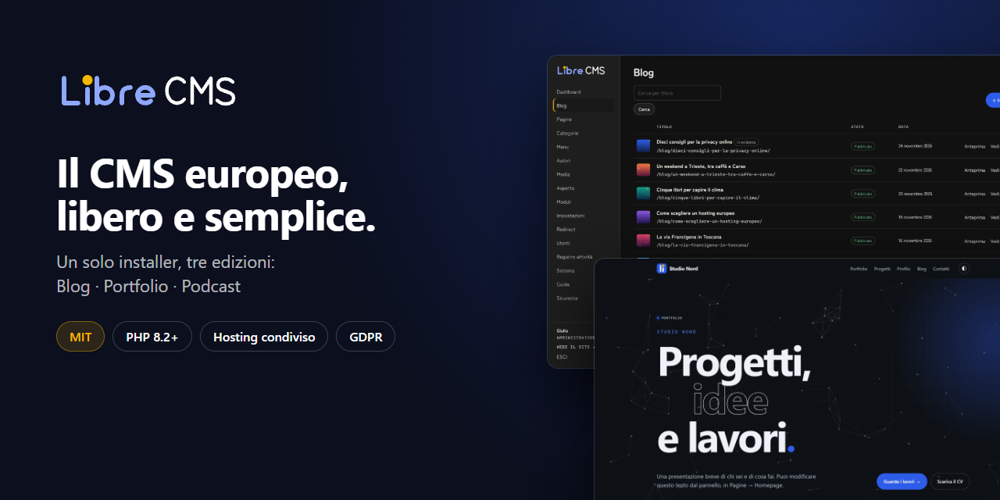

  

  <a href="https://librecms.eu"><b>librecms.eu</b></a> ·
  <a href="https://github.com/gianlucafaella/librecms/releases/latest">Scarica</a> ·
  <a href="INSTALLAZIONE.md">Guida all'installazione</a> ·
  <a href="AGGIORNAMENTO.md">Aggiornamenti</a>

  
  
  

# LibreCMS

**Il CMS europeo, libero e semplice.** Un solo installer, tre edizioni: **Blog**, **Portfolio** e **Podcast**.
Si installa su un normale hosting condiviso caricando uno ZIP: niente SSH, Composer o npm.

## Perché LibreCMS

- **Un installer, tre siti diversi.** Durante l'installazione scegli l'edizione: blog con categorie, portfolio con lavori e progetti, podcast con lettore audio e feed RSS.
- **Pronto per l'hosting che hai già.** PHP 8.2+, MySQL o MariaDB, HTTPS. L'installer controlla da solo requisiti, database e sicurezza.
- **Privacy prima di tutto.** Nessun tracciamento di terze parti, dati sul tuo server, pensato per il GDPR.
- **Sicuro di serie.** Accesso con autenticazione a due fattori, registro attività, cartella `app/` protetta.
- **Aggiornamenti senza paura.** Carichi il pacchetto dal pannello: LibreCMS verifica la firma, fa un backup e, se qualcosa va storto, torna alla versione precedente.
- **Editor visuale e revisioni.** Scrivi, programma la pubblicazione e recupera qualsiasi versione precedente.
- **Funziona con Claude Code.** Codice leggibile e documentato: puoi chiedere a un assistente AI di personalizzare temi e moduli.

## Installazione in 3 passi

1. Crea un database MySQL/MariaDB vuoto dal pannello del tuo hosting.
2. Carica `librecms.zip` nella cartella del sito (di solito `public_html`) ed estrailo.
3. Apri `https://tuosito.it/install/` e segui la procedura guidata.

Tutti i dettagli sono in [INSTALLAZIONE.md](INSTALLAZIONE.md).

## Requisiti

| | |
|---|---|
| PHP | 8.2 o superiore (consigliato 8.4) |
| Database | MySQL o MariaDB |
| Connessione | HTTPS |
| Accesso | Pannello dell'hosting o FTP |

## Licenza

LibreCMS è software libero distribuito con licenza [MIT](LICENSE.txt).
